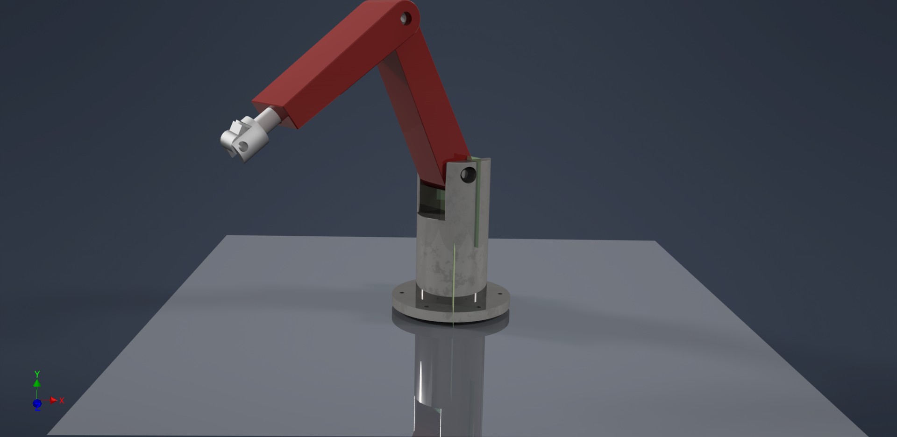

# Robotics, Mechatronics & Avionics Hardware Portfolio
**Dev Sandipkumar Naik** | B.Tech Mechanical Engineering (Minor: Robotics & Automation), DDU Nadiad  
**NPTEL National Topper (82%, Elite + Silver):** *Mechanics and Control of Robotic Manipulators (IIT Palakkad)*

---

## 1. 6-DOF Industrial Robotic Manipulator Arm (Autodesk Inventor)

* 🧊 **[Interactive 3D Browser View — Standard Resolution (.STL)](https://github.com/24mhuos028-lab/Robotics-Hardware-Portfolio/blob/main/6%20DOF%20Manipulator%20arm.stl)** *(Tap to rotate & zoom in 3D)*
* 🧊 **[Interactive 3D Browser View — High-Resolution Mesh (.STL)](https://github.com/24mhuos028-lab/Robotics-Hardware-Portfolio/blob/main/Mechanical_Assembly_6%20DOF%20Manipulator%20arm%20.stl)**
* ⚙️ **[Download Native Autodesk Inventor Assembly (.IAM)](https://raw.githubusercontent.com/24mhuos028-lab/Robotics-Hardware-Portfolio/main/6%20DOF%20Manipulator%20arm.iam)**

---

## 2. NiDAR Drone Challenge — Custom VEGAPilot WebGCS (Ground Control Station)
* 🚀 **[Launch Live Operational WebGCS Application](https://24mhuos028-lab.github.io/Robotics-Hardware-Portfolio/)** *(Hosted on GitHub Pages)*
* 🌐 **[Alternative Live Mirror](https://share.gemini.google/0Tef3JjxfFzu)**
* 💻 **[View WebGCS Source Code (HTML/JS/CSS)](./index.html)**

---

## 3. Robofest Gujarat 6.0 — Autonomous Drone Swarm Avionics (KiCad 10.0.5)
Complete 5-sheet hierarchical schematic architecture for a sub-750g GPS-denied minefield navigation drone swarm:

* 📄 **Sheet 1: Central Avionics Interposer & Power Distribution (PDB)**  
  👉 **[Open on Mobile / Direct PDF](https://raw.githubusercontent.com/24mhuos028-lab/Robotics-Hardware-Portfolio/main/Subsytem_1_Central_Avionics_Interposer_and_PDB.pdf)** | **[View in GitHub Desktop](https://github.com/24mhuos028-lab/Robotics-Hardware-Portfolio/blob/main/Subsytem_1_Central_Avionics_Interposer_and_PDB.pdf)**  
  *SpeedyBee F405 FC, Raspberry Pi 4 companion interface, ELRS receiver, and 5V/3.3V UBEC routing.*

* 📄 **Sheet 2: Propulsion & 35A 4-in-1 ESC Power Conditioning**  
  👉 **[Open on Mobile / Direct PDF](https://raw.githubusercontent.com/24mhuos028-lab/Robotics-Hardware-Portfolio/main/Subsystem_2_Propulsion_and_Motor.pdf)** | **[View in GitHub Desktop](https://github.com/24mhuos028-lab/Robotics-Hardware-Portfolio/blob/main/Subsystem_2_Propulsion_and_Motor.pdf)**  
  *4-motor 3-phase power delivery with `SMAJ18A` 18V TVS transient suppression and `470 µF` 35V bulk decoupling.*

* 📄 **Sheet 3: Optical Flow, LiDAR & 15-Pin MIPI CSI Camera Interface**  
  👉 **[Open on Mobile / Direct PDF](https://raw.githubusercontent.com/24mhuos028-lab/Robotics-Hardware-Portfolio/main/Subsystem_3_Optical_Flow,LiDAR_and_Camera.pdf)** | **[View in GitHub Desktop](https://github.com/24mhuos028-lab/Robotics-Hardware-Portfolio/blob/main/Subsystem_3_Optical_Flow,LiDAR_and_Camera.pdf)**  
  *MicoAir MTF-01 UART odometry and 15-pin MIPI CSI camera bus with `4.7 kΩ` I2C pull-ups and `100 nF` decoupling.*

* 📄 **Sheet 4: ESP32-S3 Wireless Swarm Mesh & WS2812B LED Array**  
  👉 **[Open on Mobile / Direct PDF](https://raw.githubusercontent.com/24mhuos028-lab/Robotics-Hardware-Portfolio/main/Subsystem_4_Wireless_mesh_and_LED_Indicator.pdf)** | **[View in GitHub Desktop](https://github.com/24mhuos028-lab/Robotics-Hardware-Portfolio/blob/main/Subsystem_4_Wireless_mesh_and_LED_Indicator.pdf)**  
  *Inter-drone I2C/sync interrupt bus (`SWARM_I2C_SDA/SCL`, `SWARM_SYNC_INT`) and addressable RGB guidance strip driver.*

* 📄 **Sheet 5: ExpressLRS Radio Receiver & Safety Buzzer Circuit**  
  👉 **[Open on Mobile / Direct PDF](https://raw.githubusercontent.com/24mhuos028-lab/Robotics-Hardware-Portfolio/main/Subsytem_5_Radio_Reciever_and_Safety_Buzzer.pdf)** | **[View in GitHub Desktop](https://github.com/24mhuos028-lab/Robotics-Hardware-Portfolio/blob/main/Subsytem_5_Radio_Reciever_and_Safety_Buzzer.pdf)**  
  *Dedicated hardware kill-switch receiver link and fail-safe acoustic alarm.*

---

## 4. Academic Certification
* 🏅 **NPTEL Elite + Silver Certificate (82% — National Course Topper): Mechanics and Control of Robotic Manipulators**  
  👉 **[Open Certificate on Mobile / Direct PDF](https://raw.githubusercontent.com/24mhuos028-lab/Robotics-Hardware-Portfolio/main/NPTEL_Manipulators_Certificate_Dev_Naik.pdf)** | **[View in GitHub Desktop](https://github.com/24mhuos028-lab/Robotics-Hardware-Portfolio/blob/main/NPTEL_Manipulators_Certificate_Dev_Naik.pdf)**
